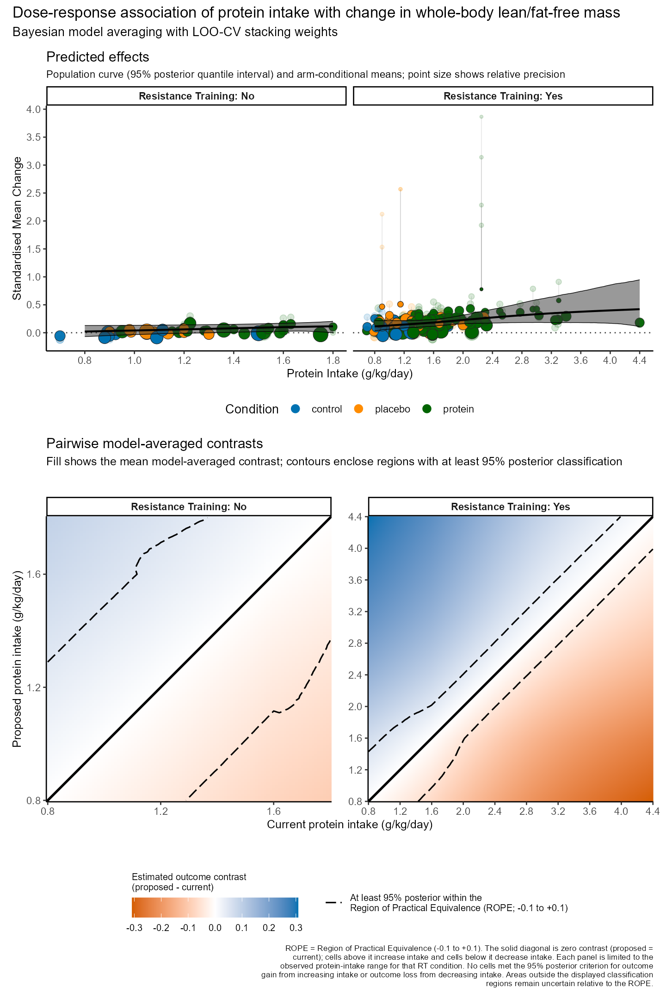
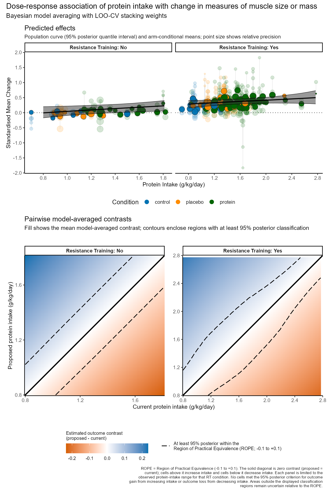
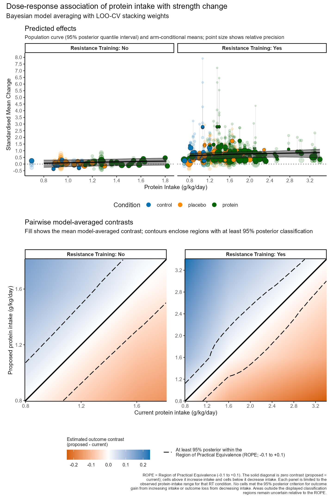
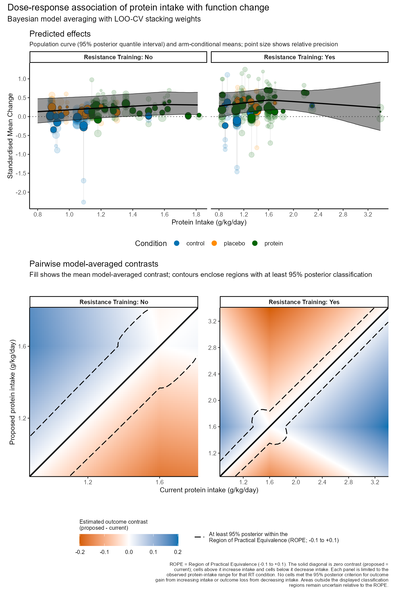



These figures accompany the primary relative-intake results in the manuscript. In the top panels, faint points show the original observed standardised mean changes, and filled points with dark outlines show the corresponding arm-conditional posterior means. Each thin vertical line connects an observed effect size to its corresponding mean at the same protein intake. Multiple observations can share an arm profile and its conditional mean. Larger filled points indicate greater posterior precision. The black curves show the model-averaged population means and the shaded bands their 95% posterior intervals.

The lower panels show model-averaged pairwise contrasts of proposed minus current intake within the observed ranges for each resistance-training condition. Cells above the diagonal compare an increase in intake and cells below it compare a decrease. Dashed contours enclose contrasts meeting the 95% posterior-probability criterion for practical equivalence.

## Whole-body lean/fat-free mass

{#fig-primary-whole-body-observed}

## Measures of muscle size or mass

{#fig-primary-muscle-observed}

## Strength

{#fig-primary-strength-observed}

## Physical function

{#fig-primary-function-observed}
