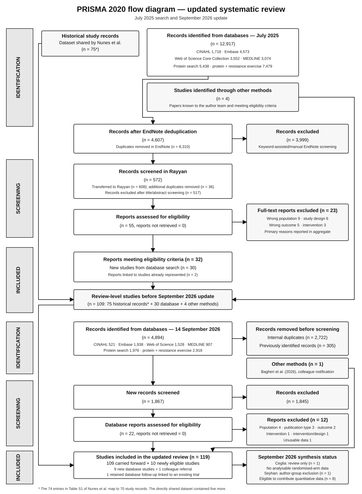

```{=html}
<style>
.callout-important { border-left-color: #8b1e1e; }
.reconcile-grid {
  display: grid;
  grid-template-columns: repeat(auto-fit, minmax(210px, 1fr));
  gap: 0.9rem;
  margin: 1rem 0 1.5rem 0;
}
.reconcile-card {
  border: 1px solid #c7c7c7;
  border-radius: 0.35rem;
  padding: 0.8rem 0.9rem;
  background: #fafafa;
}
.reconcile-card .number {
  display: block;
  font-size: 1.65rem;
  line-height: 1.1;
  font-weight: 700;
}
.reconcile-card .label {
  display: block;
  margin-top: 0.35rem;
  color: #444;
}
.prisma-flow {
  width: 100%;
  height: auto;
  border: 1px solid #ddd;
  background: white;
}
table {
  display: block;
  width: 100%;
  max-width: 100%;
  overflow-x: auto;
  font-size: 0.92rem;
}
td { vertical-align: top; }
.status-note { font-size: 0.93rem; color: #444; }
</style>
```

# Scope

This supplement documents study identification, selection, and inclusion under PRISMA 2020 [@pagePRISMA2020Statement2021]. It reconciles the search and screening counts with the study register and links the checklists to the manuscript and analytical supplements.

The official PRISMA site provides separate flow templates for updated reviews and for reviews using databases plus other identification methods. This review needs both features because it updates a previous review and the manuscript states that eligible papers known to the author team were included.

The historical dataset shared directly by Nunes et al. [-@nunesSystematicReviewMetaanalysis2022] contributed 75 study records to the review. The [historical crosswalk](#comparison-with-the-nunes-included-study-list) reconciles these records with the 74 numbered entries in the published Table S1.

```{=html}
<div class="reconcile-grid">
  <div class="reconcile-card"><span class="number">109</span><span class="label">review-level studies before the September 2026 update</span></div>
  <div class="reconcile-card"><span class="number">10</span><span class="label">new studies meeting review eligibility in the September 2026 tranche</span></div>
  <div class="reconcile-card"><span class="number">119</span><span class="label">studies included in the updated review</span></div>
  <div class="reconcile-card"><span class="number">8</span><span class="label">September 2026 studies eligible to contribute quantitative data</span></div>
</div>
```

# PRISMA 2020 flow diagram

{.prisma-flow fig-alt="PRISMA 2020 flow diagram showing the previous review, database and other-method identification in both update waves, screening, exclusions, and 119 included study records."}

[Open the vector diagram at full size](figures/prisma-2020-updated-review-flow.svg).

The diagram adapts the official PRISMA 2020 updated-review template for a review using databases and other methods. The official templates are licensed under CC BY 4.0.

To the review team's knowledge, all reports sought were retrieved in both search waves. Keyword assistance formed part of manual screening, so a separate automation count does not apply.

# Search sources and yields

## July 2025 search

Searches were conducted on 13 July 2025 using two complementary searches in each database: a protein search and a protein-plus-resistance-exercise search.



## September 2026 update

The searches were updated on 14 September 2026. Web of Science Core Collection, MEDLINE, and Embase were restricted to publication years 2025–2026 because month-level limits were unavailable. CINAHL was updated from 1 July 2025.



Both updates replicated the database-specific search strings and filters published by Nunes et al., using the same databases and the date limits described above. The published appendix specifies MEDLINE via Web of Science, Embase, Web of Science Core Collection and CINAHL. It contains the full lines for the protein and protein-plus-resistance-exercise searches. [Published search-strategy appendix](https://pmc-oa-opendata.s3.amazonaws.com/PMC8978023.1/JCSM-13-795-s003.pdf).

# Selection flow and arithmetic audit



The database totals and all within-wave subtractions are arithmetically consistent. Two reviewers (EAN and ML) worked independently at each screening stage. In July 2025, they screened records with keyword assistance in EndNote, then screened titles and abstracts in Rayyan. A third reviewer (JS) was available to resolve disagreements. None arose.

The 305 records removed in September 2026 because they had already appeared in the July 2025 search are best reported as records removed before screening for “other reasons,” with the reason stated explicitly. They are distinct from the 2,722 internal duplicates within the September update.

Of the 22 reports assessed from the September database search, 12 were excluded and 10 were retained. Nine of the retained reports represented new trials. The tenth, Ioannidou and Waldecker (2026), followed participants from the Ioannidou et al. (2024) trial already in the register (study ID 137). A colleague separately alerted the review team to Bagheri et al. (2026), bringing the number of new trials in this update to ten. [Ioannidou and Waldecker follow-up](https://link.springer.com/article/10.1007/s11332-025-01582-9).

# Full-text exclusions

The following tables reproduce the complete references and reasons from the review team's full-text exclusions document. Some July 2025 reports have multiple reasons. The figure shows the supplied July category totals. The source table does not identify which reason was counted as primary for each report with multiple reasons.

## July 2025 search



## September 2026 update



The report-level reasons are wrong population (4), wrong publication type (3), wrong outcome (2), wrong intervention (1), combined wrong intervention/study design (1), and outcome/data unavailable in usable form (1). The three Attu reports account for all publication-type exclusions. Pang et al. is a September exclusion and is counted once under the combined reason recorded in the source table.

# Studies identified outside database searches

| Update | Study ID | Report | Identification route |
|---|---:|---|---|
| July 2025 | 159 | [Cribb et al. (2006)](https://doi.org/10.1123/ijsnem.16.5.494) | Known to the authors |
| July 2025 | 160 | [Fabre et al. (2017)](https://doi.org/10.1123/ijsnem.2016-0333) | Known to the authors |
| July 2025 | 161 | [Jacinto et al. (2022)](https://doi.org/10.1123/ijsnem.2021-0265) | Known to the authors |
| July 2025 | 162 | [Sugihara Junior et al. (2018)](https://doi.org/10.1123/ijsnem.2017-0253) | Known to the authors |
| September 2026 | 163 | [Bagheri et al. (2026)](https://doi.org/10.1080/15502783.2026.2720742) | Colleague notification |

# Comparison with the Nunes included-study list

Table S1 of Nunes et al. [-@nunesSystematicReviewMetaanalysis2022] contains 74 numbered report entries. Of these, 73 match reports explicitly represented in the current historical register. The remaining Nabuco cellular-health report is linked to the same trial as two other Table S1 reports. The crosswalk therefore maps 74 published entries to 70 historical study records. The dataset shared directly by Nunes et al. also contained the five records listed below, giving 75 historical records in the current register. [Nunes et al., Table S1](https://pmc-oa-opendata.s3.amazonaws.com/PMC8978023.1/JCSM-13-795-s004.pdf).

| Current study ID | Numbered entries in Nunes Table S1 | Current treatment |
|---:|---|---|
| 10 | 6 Aristizabal and 69 Volek | The register links both reports to one trial. |
| 45 | 25 Haun and 38 Mobley | The register links both reports to one trial. |
| 72 | 40–42 Nabuco | The register links the first two reports to one trial. The trial registration also lists the third, on cellular health, which has no separate record in the extraction. [NCT03247192](https://clinicaltrials.gov/study/NCT03247192) |

| Current study ID | Record in the shared dataset absent from Table S1 |
|---:|---|
| 33 | [Dillon et al. (2009)](https://doi.org/10.1210/jc.2008-1564) |
| 54 | [Ispoglou et al. (2016)](https://doi.org/10.1038/ejcn.2015.91) |
| 76 | [Nabuco et al. (2019), protein intake beyond habitual intakes](https://doi.org/10.1123/japa.2018-0370) |
| 96 | [Markofski et al. (2019)](https://doi.org/10.1093/gerona/gly109) and [Randolph et al. (2020)](https://doi.org/10.1016/j.clnu.2019.06.017) |
| 114 | [Vieillevoye et al. (2010)](https://doi.org/10.1007/s00421-010-1520-9) |

# Review inclusion versus quantitative synthesis

PRISMA counts studies included in the review separately from studies or results that contribute to a particular synthesis. The September 2026 extraction workbook contains ten study records. Ceglia et al. met the review eligibility criteria. The trial randomised participants to four whey-by-alkali groups, and its main outcome table reports adjusted 24-week comparisons pooled across the levels of each factor. Those results do not provide the arm-level baseline-to-follow-up changes and sampling variances used by this synthesis. The extraction retains the study and intended comparisons in the review record. Seyhan et al. is also retained at review level and was excluded from quantitative synthesis by author-group decision.

[Ceglia et al., Table 2](https://escholarship.org/content/qt8048n5zf/qt8048n5zf.pdf).



The manuscript and supplements use three denominators consistently:

- studies included in the review;
- studies contributing any analysable data;
- studies contributing to each individual outcome synthesis.

# Characteristics of the included studies

The table lists one row for each of the 119 study records. Baseline sample sizes are summed across extracted arms. If any arm size is missing, the table states how many arms are represented in the subtotal. Age, male percentage and total protein intake give the range of available arm-level summaries. Follow-up gives the range of extracted post-baseline weeks. Prescribed protein refers to extracted protein intervention arms. RT indicates whether resistance training was part of the intervention. A dash indicates no usable arm-level value. The Ceglia report presents participant characteristics pooled across factorial groups, so its pooled sex distribution is omitted from the arm-level summary. Primary outcome contributions come from the final relative-intake analysis dataset.



# PRISMA 2020 checklist register

The checklists use the printed page numbers in the 42-page manuscript dated 12 November 2026. Where the manuscript page directs readers to a supplement or dataset, the reporting location links to the detailed material.

## Final analytical cross-references

| PRISMA topic | Final online location |
|---|---|
| Quantitative eligibility and contrast exclusions | [Systematic-review data audit](systematic-review-data-audit.html) |
| Primary relative-intake plots with observed effect sizes | [Primary dose–response figures](primary-dose-response.html) |
| Relative-intake robustness analyses | [Relative-intake sensitivity analyses](sensitivity-analyses.html) |
| Absolute total-intake analyses | [Absolute total-intake analyses](absolute-intake-sensitivity-analyses.html) |
| Prescribed-supplement analyses | [Absolute supplementation analyses](absolute-supplementation-sensitivity-analyses.html) |
| Muscle measurement eligibility | [Muscle measurement analyses](muscle-measurement-sensitivity-analyses.html) |
| Age and intervention-duration heterogeneity | [Age and duration interactions](age-duration-interactions.html) |
| Training-status heterogeneity | [Training-status analyses](training-status.html) |
| Study risk of bias | [Risk-of-bias assessment](risk-of-bias.html) |
| Certainty of evidence | [GRADE appraisal](grade-appraisal.html) |
| Reporting-bias methods and results | [Publication-bias assessment](publication-bias.html) |
| Deviations and post-registration additions | [Preregistration deviations](preregistration-deviations.html) |
| Individual-study results and inputs | [Primary analysis data](../manuscript/generated/reporting/primary-study-effects.csv.gz) and [extraction data and analysis code](https://github.com/jamessteeleii/protein_dose_response_meta) |
| Characteristics and risk of bias by synthesis | [Study characteristics](#characteristics-of-the-included-studies), [primary sample by outcome](systematic-review-data-audit.html#current-analysis-dataset) and [risk of bias by synthesis](grade-appraisal.html#risk-of-bias) |
| Primary synthesis estimates, precision and inconsistency | [Primary dose–response estimates](../manuscript/generated/reporting/bundles/primary_update_2026/dose_response_predictions.csv.gz) and [primary model diagnostics](preregistration-deviations.html) and [GRADE inconsistency assessment](grade-appraisal.html#inconsistency) |

## Main checklist



## PRISMA 2020 for Abstracts



# Source provenance

The search counts and exclusion references were transcribed from the files supplied in data/PRISMA. The review team confirmed the source of the historical dataset and the identification route for Bagheri et al. and supplied the September report list. Workbook-level reconciliation used the 109 study records in data/protein_meta_data_all.xlsx, the ten study records in data/update_2026/protein_meta_data_update_2026.xlsx, and the quantitative-synthesis decisions in data/update_2026/review_decisions.csv. The machine-readable ledgers used to build this report are stored in supplement/data.

Editable source ledgers: [database search counts](data/prisma-search-counts.csv), [selection-flow counts](data/prisma-flow-counts.csv), [full-text exclusions](data/prisma-full-text-exclusions.csv), and [checklist audit register](data/prisma-checklist-register.csv).

# Guideline

This supplement follows PRISMA 2020 [@pagePRISMA2020Statement2021] and the official updated-review flow template. PRISMA is a reporting guideline; checklist completion does not by itself establish methodological quality.
